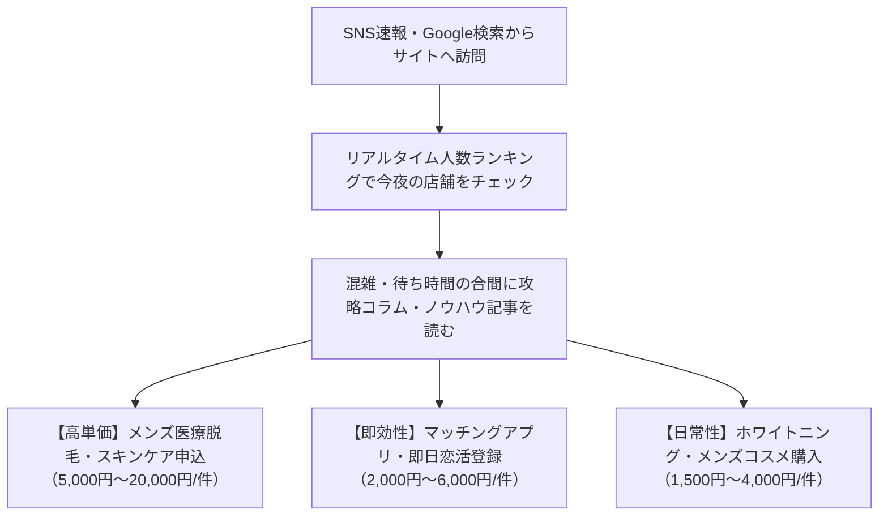

# 相席ナビ（Aiseki Navi）メディア化＆収益化戦略構想メモ
**作成日**: 2026年10月20日  
**プロジェクト**: 全国ラウンジ混雑速報 ＆ 相席・夜遊び攻略ポータル化構想

---

## 1. 全体ビジョンと基本方針

### 🎯 目指すポジション
> **「日本一リアルで役立つ、相席ラウンジ・出会い攻略の専門ポータル」**

### 💡 最大の強み（競合が絶対に真似できない差別化）
* **従来のまとめブログ**: 個人の主観的な体験談のみで、客観的なデータがない。
* **相席ナビ**: 全国65店舗以上の**リアルタイム来店人数・男女比・曜日×時間帯別グラフ（一次情報）**を保持。
* **結論**: 「リアルタイム混雑データ（便利ツール）」×「知見・イロハ・攻略（メディア）」を合体させることで、圧倒的な説得力・信頼性・SEO検索上位を獲得する。

---

## 2. ドメインについての検討・推奨方針

### 結論：独自ドメインの取得を強く推奨（月150円前後で絶大な効果）
現在使用している `https://lounge-monitor2.onrender.com/` はRender提供の無料サブドメインです。本格的なメディア化を進めるにあたって、独自ドメインへの移行には以下の明確なメリットがあります。

| 比較項目 | 現在（onrender.com） | 独自ドメイン（.com / .jp など） |
| :--- | :--- | :--- |
| **SEO（検索上位）** | サブドメイン扱いとなり評価が分散 | サイト独自のドメインパワーが蓄積され上位表示されやすい |
| **信頼感・ブランド** | 開発中の仮URLのように見える | 公式メディアとしての安心感・クリック率が大幅アップ |
| **将来のサーバー移行** | Render以外のサーバーに移した時にこれまでのSEO評価がリセット | サーバーを引っ越してもSEO資産がそのまま引き継がれる |
| **費用** | 無料 | 年間1,500円〜2,000円程度（月150円以下） |

### 🌐 ドメイン名のおすすめ候補案
* `aiseki-navi.com`（最もおすすめ・王道・ブランドに一致）
* `aisekinavi.jp`（国内向けで信頼感が高い）
* `aiseki-ranking.com`（ランキング・混雑速報感が伝わる）
* `lounge-navi.com`（スタイリッシュな響き）

> **切り替えのタイミング**:  
> いつでも移行可能です。Renderの管理画面（Settings → Custom Domains）にドメインを追加するだけで、自動でSSL（https）対応・数分で切り替えられます。記事を本格的に書き始める前後のタイミングで取得するのが最もスムーズです。

---

## 3. コンテンツ企画（読まれる記事＆キラーコンテンツ案）

### カテゴリA：立ち回り・トークのイロハ（リピート＆SNS拡散用）
1. **「相席ラウンジでLINE交換率・2軒目連れ出し率を倍にする『最初の3分トーク術』」**
   * 最初のお互いの自己紹介で盛り上がる共通の話題
   * 「ハズレ席」と感じさせないスマートな相席マナー
2. **「女性陣がドン引きする男性のNG行動・会話ワースト5」**
   * 仕事の自慢話、面接のような質問攻め、強引なスキンシップ対策
3. **「男女比グラフから読み解く！相席ラウンジで『最も勝率が高い黄金タイム』」**
   * 金曜・土曜の20時台早め入店 vs 22時台後半の立ち回り比較
4. **「会計・料金システム完全ガイド：男性が安く賢く楽しむ裏技」**
   * チャージ料・飲み放題・深夜料金の仕組みとお得なクーポン活用法

### カテゴリB：ブランド・店舗の徹底比較（Google検索流入・SEO用）
1. **「【2026年最新】オリエンタルラウンジ vs ag vs JIS 違いを徹底比較！」**
   * 年齢層・料金・内装の雰囲気・客層（学生多め/OL多め）の違い
2. **「初めての相席ラウンジ入門：入店から相席・チェンジ希望の出し方まで」**
3. **「エリア別攻略（新宿・渋谷・梅田・難波・福岡天神など）激戦区のハシゴ術」**

### カテゴリC：男磨き・清潔感（メンズ脱毛・美容アフィリエイト用 💰高単価）
1. **「暗い照明のラウンジで差がつく！女性が真っ先にチェックしている清潔感の正体」**
   * 夜の青ヒゲ対策（メンズ医療ヒゲ脱毛の必要性）
   * 照明下での肌のテカリ・毛穴対策
2. **「相席に行く前にやっておくべき身だしなみチェックリスト」**
   * 口臭・ホワイトニング、眉毛サロン、上品に香るメンズ香水

### カテゴリD：空振り対策・アプリ併用術（マッチングアプリ・出会いアフィリエイト用 💰）
1. **「相席が満席・男性余りだった時のすれ違い対策：今夜すぐ近くで合流できる即日アプリ併用術」**
2. **「相席ラウンジ vs マッチングアプリ どっちが出会える？目的・予算別の使い分け」**

---

## 4. 収益化（アフィリエイト）導線設計

---

## 5. 実装ロードマップ（段階的な進め方）

* [x] **フェーズ1（基盤完成）**:
  * 全国65店舗リアルタイム混雑集計＆ランキング表示
  * 店舗別詳細グラフ（曜日×時間帯）
  * X自動速報ポスト機能＆手動共有モーダル
  * 4モード表示切替（通常・リスト・フラット・ライト）
  * A8.net公式バナー＆インフィードPRカード枠設置
* [ ] **フェーズ2（メディア導線・記事レイアウト構築）**:
  * 記事ページ用テンプレート（スマホで読みやすい記事デザイン）の作成
  * ヘッダー・フッターに「知見・コラム」導線を追加
* [ ] **フェーズ3（独自ドメイン移行）**:
  * `aiseki-navi.com` 等の取得＆Renderへの設定
* [ ] **フェーズ4（キラー記事の順次投入・SEO強化）**:
  * 上記の知見・イロハ記事を定期的に追加
  * 各記事末尾に「今夜の店舗の混雑を見る」「おすすめ美容・アプリ」を設置
